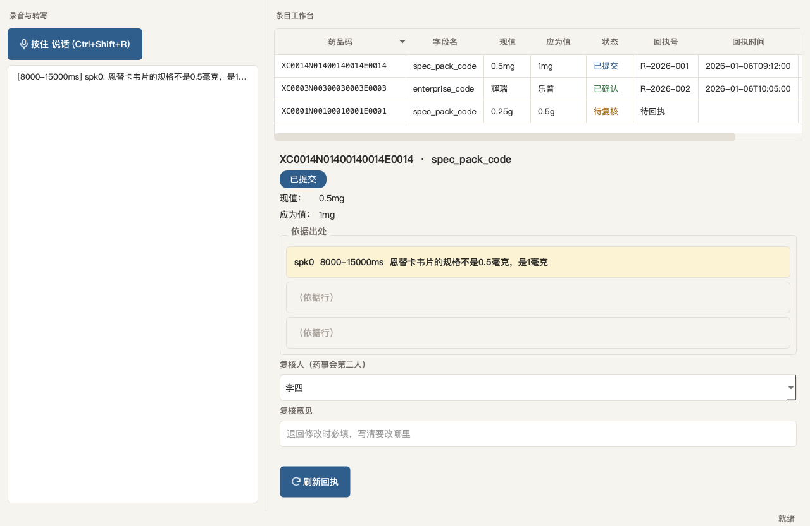
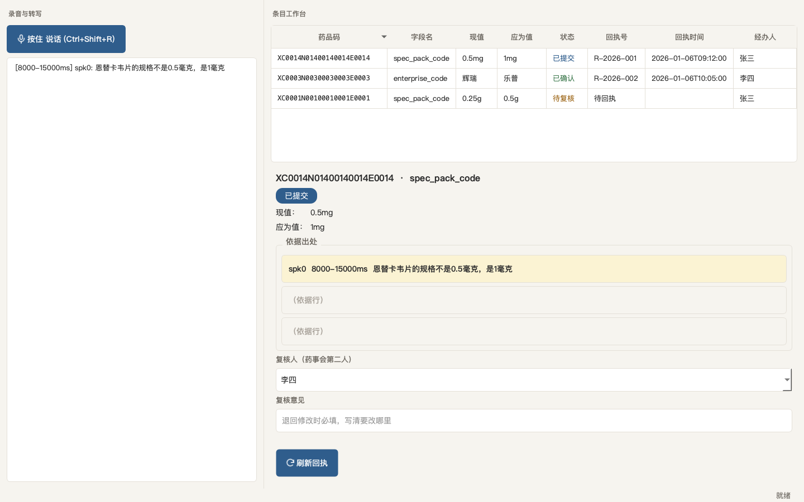
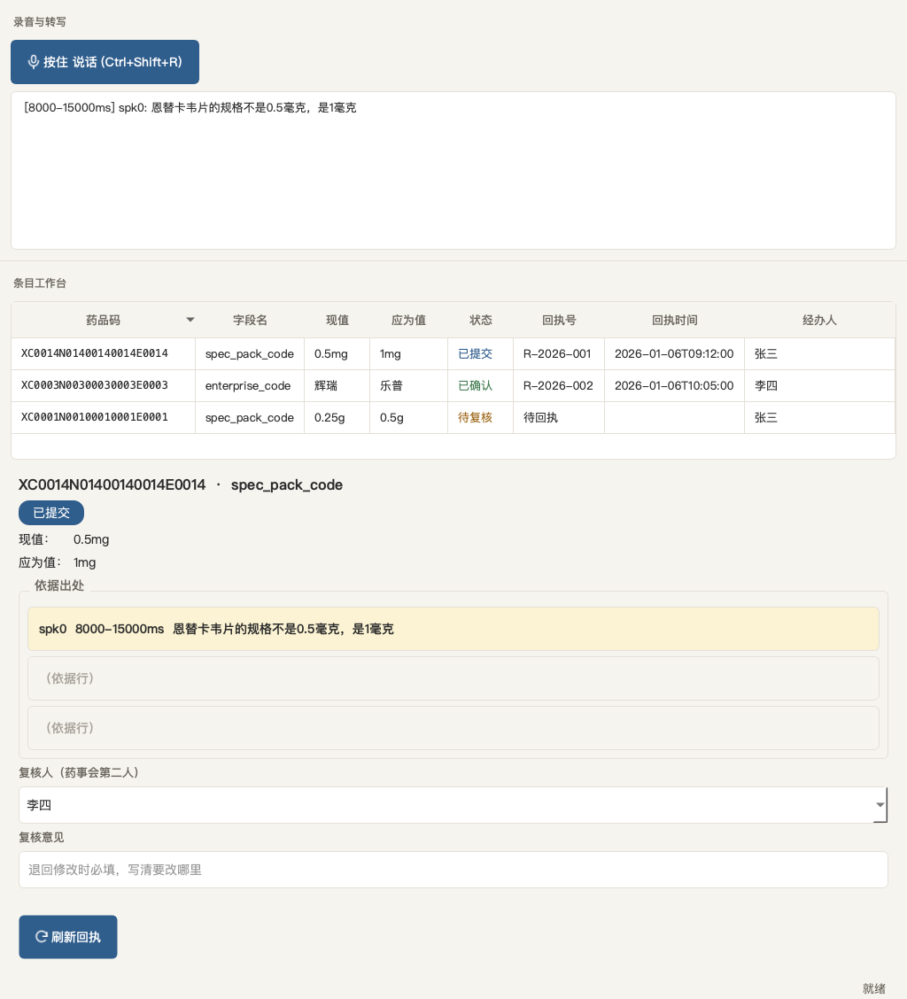
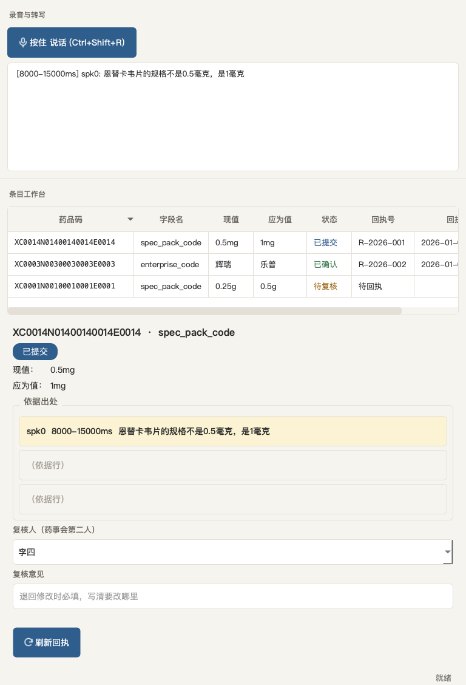
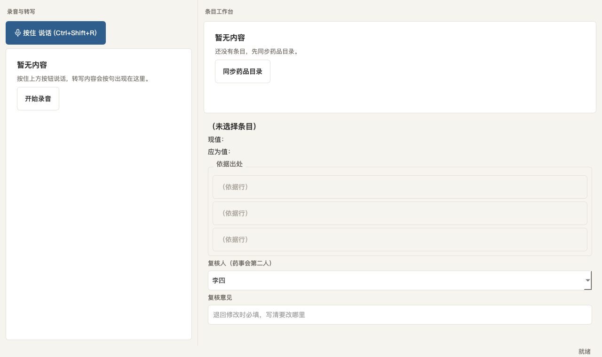
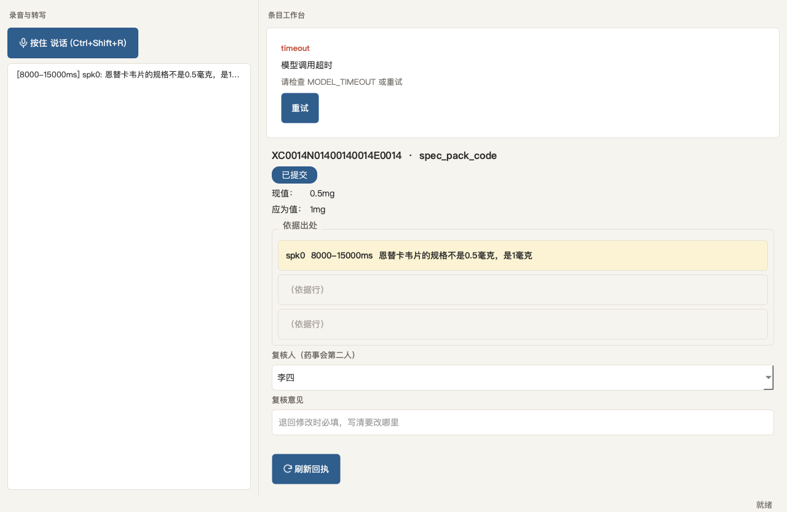
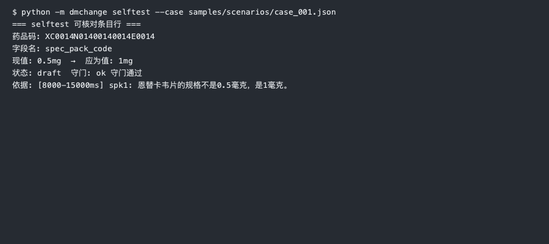
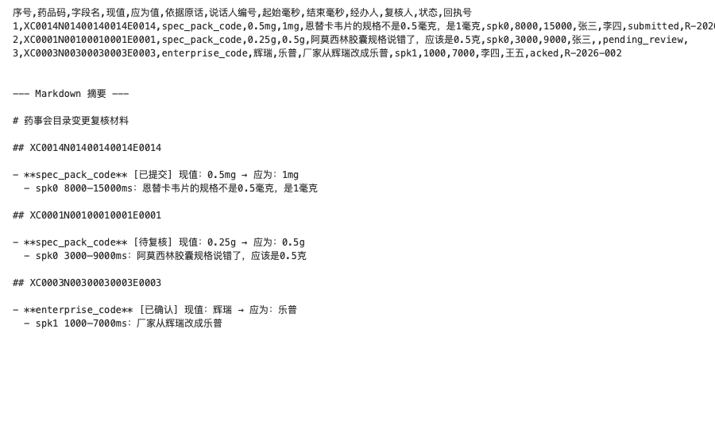

# 药品主数据变更听写系统

> 药事岗对着麦克风把一次药品目录核实的结论说一遍，松手后窗口里就多出一张填好药品码、字段名、现值、应为值的变更条目草稿。每条要素都带着那句原话和它的绝对时间。经药事岗确认、药事会第二人复核之后才写回主数据系统，这条目录为什么这么改，能查到人、查到时间、查到那句原话。

这是装在**药学部共用 PC** 上的桌面常驻小工具（托盘常驻 + 主窗口）。它把临床科室或供应商来电口头核实药品目录这件事，从手敲表单 6 至 10 分钟变成说完话就有草稿，并保证每一条变更都带着可回查的原始出处。

录音**默认不落盘、不出本机**，识别在本机离线完成。只有人工确认加第二人复核之后，条目才会以正式的**主数据变更单**写回院内主数据平台。

---

## 适用场景 / 目标岗位

| 岗位 | 什么时候用 | 得到什么 |
|------|------------|----------|
| 药学部药事岗（经办） | 临床科室或供应商来电、当面口头核实药品的通用名、剂型、规格、厂家 | 一张要素齐备的变更条目草稿：药品码、字段名、现值、应为值，每条都带说话人、原话与起止时间 |
| 药事会复核人 | 药事会前批量复核目录变更 | 待复核列表点开即见依据原文；系统在提交那一刻强制校验复核人不同于经办人，不留纸签痕迹 |
| 主数据管理员 | 变更单落库与回执跟踪 | 条目行上直接显示回执号与回执时间；被驳回时把驳回原因写在行内 |

---

## 能力要点

- **说完话就有草稿**：按住说话说完松手，窗口按语音段逐行出句（约 0.6 至 1 秒一句，不逐字），再压成一张逐项带出处的变更条目草稿。
- **药品码和字段名不猜**：药品码与字段名由院内药品目录硬匹配决定。通用名命中多条目录记录时拒绝歧义、列候选交给人，不替你猜一个。
- **否定式纠正读得对**：口语里「不是 0.25，是 0.5」的方向由模型判定，数值本身仍由规则解析，界面与导出一律显示原话原文，口径不静默换算。
- **每条要素都带出处**：依据原话、说话人、绝对毫秒区间随要素同行走，点开就能看到是哪一句说的，导出给药事会的材料里也带着。
- **双人复核写死在代码里**：药事岗确认只是生成条目，药事会第二人复核通过才允许出站写回。同一人复核在代码层被拦下，一次出站请求都不会发出。
- **改了什么能查到谁**：只增不改的审计链记下谁、何时、哪个药品码的哪个字段、从什么值改到什么值、依据哪几句原话，内审与药事会都能调阅。

---

## 快速开始

**启动桌面程序（第一步）**：装好依赖后，双击桌面图标或执行下面的命令即可看到主窗口——左侧是「录音与转写」（「按住 说话」按钮 + 逐句转写），右侧是「条目工作台」（变更条目表 + 条目详情），程序同时进系统托盘常驻。日常核实、确认、复核全部在这个窗口里点，不需要碰终端。

```bash
python -m dmchange
```

### 依赖

- Python **≥ 3.10**
- **ffmpeg**：把任意音频（wav / mp3 / m4a）与麦克风原始流统一到 16 kHz 单声道。无 ffmpeg 时对 wav 走标准库兜底。
- 离线识别模型包 4 件：`paraformer-zh`、`fsmn-vad`、`ct-punc`、`cam++`
- 院内可达的两个端点：主数据平台与模型服务

详细的离线装机步骤见 `docs/deploy-offline.md`。

### 安装与配置

```bash
python3 -m venv .venv && source .venv/bin/activate
pip install -r requirements.txt
pip install -e .
cp .env.example .env          # 按院内实际地址填写九项凭据位
python scripts/fetch_offline_models.py --out ./offline-models
```

所有凭据与端点一律从环境变量读取，代码里零硬编码密钥。缺项时启动明确报错并列出缺哪几项，不会回落到本地替身地址。

### 构建与验证

```bash
pytest -q                                                   # 全量测试
python -m dmchange selftest --case samples/scenarios/case_001.json  # 端到端自检
python -m dmchange doctor                                   # 运维自检清单
```

### 主命令速查

```bash
python -m dmchange                        # 启动桌面程序（主入口）
python -m dmchange doctor                 # 自检：模型包 / 端点 / 凭据位
python -m dmchange sync-dictionary        # 同步药品目录快照
python -m dmchange selftest --case <路径> # 端到端自检
python -m dmchange export --out out.csv   # 导出药事会材料
```

CLI 只作运维与排障通道，完整参数见 `docs/cli.md`。

---

## 命令 / API / 配置说明

### 关键配置项

| 配置项 | 默认值 | 说明 |
|--------|--------|------|
| `MDM_BASE_URL` | 无（必填） | 主数据平台根地址，目录同步、变更单写回、回执回读都用它 |
| `MDM_TOKEN` | 无（必填） | 主数据平台访问令牌，作为 Bearer 令牌下发 |
| `MODEL_BASE_URL` | 无（必填） | 模型服务根地址，调用路径 `{MODEL_BASE_URL}/v1/chat/completions` |
| `MODEL_API_KEY` | 无（必填） | 模型服务令牌 |
| `MODEL_NAME` | 无（必填） | 参与要素抽取的模型名 |
| `MODEL_TIMEOUT` | `30` | 模型调用超时（秒），超时后走确定性降级路径 |
| `ASR_MODE` | `local` | `local` 为本机离线识别，`openai-compatible` 为院内语音服务 |
| `ASR_BASE_URL` | 无（local 模式不需要） | 院内语音服务根地址 |
| `ASR_API_KEY` | 无（local 模式不需要） | 院内语音服务令牌 |

### CLI 子命令 / 接口端点

| 命令或路径 | 用途 | 关键参数 |
|------------|------|----------|
| `python -m dmchange` | 启动桌面程序（托盘常驻） | `--demo` 显式开启演示模式（产物带演示数据标记） |
| `python -m dmchange doctor` | 自检模型包、端点、凭据位 | 无 |
| `python -m dmchange sync-dictionary` | 同步药品目录快照 | 无 |
| `python -m dmchange selftest` | 端到端自检并打印条目行 | `--case <路径>` |
| `python -m dmchange export` | 导出药事会材料 | `--out <路径>` |
| `POST {mdm_base_url}/api/v1/master-data/changes` | 出站写：提交变更单 | 头含 Bearer 令牌与 `Idempotency-Key: {change_id}` |
| `GET {mdm_base_url}/api/v1/drug-dictionary` | 入站读：同步目录 | 查询参数 `updated_since` |
| `GET {mdm_base_url}/api/v1/master-data/changes/{change_id}` | 入站读：回读回执 | 头含 Bearer 令牌 |
| `POST {model_base_url}/v1/chat/completions` | 出站写：要素抽取 | body 带 `response_format=json_object` |

### 错误与降级

| 场景 | 表现 | 处理方式 |
|------|------|----------|
| 模型不可达 / 超时 / 返回体不合规 | 顶部错误条，审计记 `error_class` | 条目落库但 `status=draft_incomplete`，只带转写与出处，不出站、不推进状态 |
| 药品码不在目录 / 通用名命中多条 | 条目行标红并列出候选药品码 | 停在 `draft` 不放行，需人工指定药品码 |
| 目录同步失败 | 顶部提示「目录已过期（上次 HH:MM）」 | 沿用上次快照，不阻断已有条目 |
| 说话人聚类不足 2 人 | 说话人列显示「未分离」 | 不产出两个角色，编号只作辅助列 |
| 音频引擎起不来 | 错误条提示缺哪个模型包、脚本在哪 | 允许导入音频走同一管线，或切 openai-compatible；不静默产出空结果 |
| 出站失败 | 状态停在 `submitted`，状态条显示重试中 | 进 outbox 队列按指数退避重试，绝不标成已确认 |

### 对接现有系统

只对接主数据平台。药品目录值以主数据平台为准源，本产品不直连 HIS 药房、药事系统、物价管理，避免形成第二事实源。相邻系统只通过主数据变更单这一条正式接口间接联动。

出站请求体字段位与 spec 逐项对齐，字段规范见 `docs/mdm-change-schema.md`。幂等键由 `sha256(drug_code | field_name | cur_value | proposed_value | evidence_sha256)` 算出，不含时间戳与重试次数，同一核实重复提交不产生第二条。本地协议替身只存在于测试数据层，默认启动路径直连真实端点。

---

## 典型场景

### 场景 1：药事岗接到临床来电核实规格

在窗口按住「说话」把结论说完，松手后看转写区逐行出句，约 2 秒后条目表多出一行草稿：药品码来自目录硬匹配、字段名为规格、应为值为结论值，依据挂着那句原话。等价排障命令：

```bash
python -m dmchange selftest --case samples/scenarios/case_001.json
```

### 场景 2：药事岗核实厂家变更

按住「说话」说出「厂家从辉瑞改成乐普」，松手后详情页显示企业码字段、现值辉瑞、应为值乐普，依据行带说话人编号与毫秒区间。点依据行可在转写区高亮对应句子。

### 场景 3：药事岗遇到通用名多命中

说出「阿莫西林胶囊规格改成 0.5 克」，但目录里该通用名有多条记录。条目药品码留空并列出候选、标「药品码待人工指定」，状态停在草稿不放行。药事岗在详情页从候选里点选正确药品码即可继续。

### 场景 4：药事会复核人批量复核

药事会前把条目按状态筛成「待复核」，逐条点开看依据出处三行。在复核人下拉框选一个不同于经办人的人，点「复核通过并出站」。选到与经办人相同的人时按钮自动禁用并给出提示。

### 场景 5：药事会复核人退回修改

发现某条规格口径不对，填复核意见后点「退回修改」。条目回到可编辑态，复核意见原文与退回时间显示在详情页。药事岗改好后点「修改后重提」，旧提交在审计链里仍可回溯。

### 场景 6：主数据管理员追一条被驳回的变更

在条目表按状态筛「已提交」，点开详情刷新回执。端点回读后状态变成「已驳回」，行内显示驳回原因首句，完整原因在详情页。按驳回原因修改后重新提交即可。

### 场景 7：信息科导出药事会材料

核实与复核完成后点「导出药事会材料」，生成带依据原话与起止毫秒的 CSV，UTF-8 带 BOM，Excel 直接打开，可附在药事会纪要后。等价命令：

```bash
python -m dmchange export --out 药事会材料.csv
```

---

## 输出样例

> 下列片段为脱敏样例，药品码与厂家均为占位值；真实产物由 export 命令生成。

### 条目表片段

| 药品码 | 字段 | 现值 | 应为值 | 依据 | 状态 |
|---|---|---|---|---|---|
| `<示例药品码>` | 规格包装 | 0.25g | 0.5g | 00:08 至 00:15 药事岗 | 草稿 |
| `<示例药品码>` | 剂型 | 注射剂 | 粉针剂 | 00:31 至 00:36 临床科室 | 待复核 |

### 导出 CSV 片段

```csv
序号,药品码,字段名,现值,应为值,依据原话,说话人,起始毫秒,结束毫秒,经办人,复核人,状态,回执号
1,<示例药品码>,spec_pack_code,0.25g,0.5g,那个规格说错了不是0.25是0.5,spk0,8000,15000,张药师,李主任,submitted,RCPT-0001
```

### 终端 selftest 输出

```text
=== selftest 可核对条目行 ===
药品码: XC0014N01400140014E0014
字段名: spec_pack_code
现值: 0.5mg  →  应为值: 1mg
状态: draft  守门: ok 守门通过
依据: [8000-15000ms] spk1: 恩替卡韦片的规格不是0.5毫克，是1毫克。
```

完整样例见 `docs/examples.md`。

---

## 概念 / 实测对照

### 视觉目标

`docs/concepts/visual-target.md` 是结构化视觉目标卡，写明三个状态、配色色值（主色 `#2F5D8C`、底色 `#F6F4EF`、标错 `#C0503A`、成功 `#3F7A4F`）、字体层级与信息密度，以及必须可达的约束（不画逐字动画、不画情绪曲线）。本轮不伪造概念图，只保留结构化目标卡。六项界面选型决策（渲染栈、组件与样式、图标与字体、动效、数据可视化、视觉验收）写在 `docs/ui-stack.md`。

### 实测证据

以下均为真实运行截图（Qt `QWidget.grab()` 抓真实渲染结果，套真实 QSS、灌真实条目数据），可由 `python scripts/capture_screenshots.py` 复现。

**主窗口 1280 宽（应用默认窗口尺寸，条目表为主角）**



**主窗口 1440 宽（左右分栏，条目表为主角）**



**主窗口 1024 宽（上下排布，表格拿整幅宽度）**



**主窗口 768 宽（上下排布）**



**空态：不是空白页，是文案 + 下一步动作**



**错态：错误码 + 说明 + 重试**



**真实终端会话**



同一段回显的**原始文本产物**（`python -m dmchange selftest` 的真实 stdout，可直接打开核对）：`docs/screenshots/terminal_selftest.txt`

**真实导出报告片段**



> **诚实标注**：上方 `docs/concepts/` 是视觉目标，下方 `docs/screenshots/` 是真实实测。两者在信息密度、留白密度与视觉完成度上必然存在差距，由 `docs/concepts/visual-target-gap.md` 如实记录，不声称完全一致，也不用事后效果图抹平差距。截图里也没有焦点态与悬停态——那两态靠 `theme.qss` 的规则与机检保证，不靠截图证明。

---

## 架构与数据流

```
麦克风 / 导入音频 → 音频统一化(16k单声道PCM) → VAD分段 → 段驱动增量解码
→ Utterance[]句级归一 → ModelGateway要素抽取(JSON Schema校验)
→ 目录守门(结构/字典/业务三层 · 歧义拒绝) → 台账与状态机
→ MDM出站(Idempotency-Key) → 回执回读 → 药事会材料与审计链导出
```

### 关键不变量

- **幂等键不含时间戳与重试次数**：同一核实重复提交库中只落一条，出站带同一个 Idempotency-Key。
- **复核人不同于经办人**由代码强校验，同人复核在出站之前被拦下，不产生任何出站请求。
- **失败不静默改数据**：模型不可达停在 draft_incomplete 且不出站；出站失败停在 submitted 且绝不标成已确认；目录多命中停在 draft 不放行。
- **口径不静默换算**：现值与应为值的原文与归一值分别存，界面与导出一律显示原文。
- **审计链只增不改**：审计表只提供追加与查询，不存在改写或删除路径。
- **录音默认不出本机、不落盘**：仅保留转写文本与出处毫秒。

状态机图、审计链字段与出站时序见 `docs/architecture.md`。

---

## 安全与合规边界

本产品不涉及患者数据，处理的只有药品目录条目与目录值，无患者标识。录音默认不出本机、默认不落盘，可选本地留存目录默认关闭。模型输出在任何情况下不直接推进主数据状态，必须经药事岗确认加药事会第二人复核两步才出站。本产品只做药品目录值的核实与变更记录，不产出诊断、不产出治疗建议、不代签任何文书。

---

## 验收与自检

| 验收项 | 命令 | 期望结果 |
|--------|------|----------|
| 全量测试 | `pytest -q` | 全部通过 |
| 端到端自检 | `python -m dmchange selftest --case samples/scenarios/case_001.json` | 打印含药品码、字段名、原话、毫秒区间的条目行 |
| 运维自检 | `python -m dmchange doctor` | 输出模型包、端点、凭据位清单 |
| 场景回放 | `python scripts/replay_scenarios.py` | 12 条场景逐条命中判定并生成报告 |
| 出站演练 | `bash scripts/e2e_rehearsal.sh` | 正向与两类负向断言命中 |
| 发布校验 | `bash scripts/verify_release.sh` | 安装、自检、守门、导出逐步通过 |
| 截图复现 | `python scripts/capture_screenshots.py` | 三类真实截图重新生成 |

---

## 项目结构

```
drug-masterdata-change/
├── README.md                      本文件：面向医院用户的产品说明
├── requirements.txt / pyproject.toml / .env.example / .gitignore
├── qrcode.jpg                     关注公众号二维码
├── docs/
│   ├── concepts/                  视觉目标卡与差距记录
│   ├── screenshots/               真实运行截图（终端 / 界面 / 导出）
│   ├── cli.md / architecture.md / examples.md
│   └── deploy-offline.md / mdm-change-schema.md
├── samples/
│   ├── dictionary_snapshot.json   脱敏药品目录快照
│   ├── drug_codes.json            药品码合法与非法样例集
│   ├── scenarios/case_*.json      口头核实场景集（含期望标注）
│   └── benchmarks/                对照实验与规模跑批结果
├── scripts/                       样例获取 / 截图采集 / 回放 / 演练 / 发布校验
├── src/dmchange/
│   ├── __main__.py / cli.py / config.py / logging_utils.py
│   ├── domain/                    状态枚举 / 药品码校验 / 异常层级
│   ├── audio/                     音频统一化 / 采集 / VAD 分段
│   ├── asr/                       引擎装配 / 段驱动解码 / 归一 / 热词
│   ├── extract/                   模型网关 / 抽取 / 守门 / 证据 / 解析 / 角色
│   ├── dictionary/                目录存储 / 匹配 / 同步客户端
│   ├── ledger/                    SQLite 台账 / 状态机 / 仓储 / 审计 / 幂等
│   ├── outbound/                  MDM 客户端 / outbox / 回执
│   └── ui/                        托盘 / 主窗口 / 条目表 / 详情页 / 设计 token
└── tests/                         单元测试与协议兼容测试（替身只在本目录）
```

---

## License

MIT

---

## 关注我们

欢迎扫码关注公众号，获取项目更新与交流加群：

